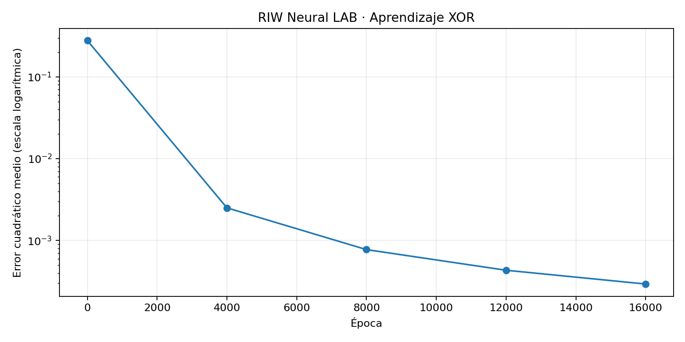

# RIW Neural LAB · Experimento 001


## Cinco neuronas, cuatro respuestas y ninguna magia

Implementación didáctica de una **red neuronal multicapa (MLP)** desde cero, utilizando Python y NumPy, sin PyTorch ni modelos preentrenados.

**Objetivo:** aprender la función XOR con 2 entradas, una capa oculta de 4 neuronas y una salida sigmoide. La red ajusta 17 parámetros entrenables (8 + 4 + 4 + 1) mediante retropropagación y descenso de gradiente por lotes.

## Reproducir

```bash
python3 -m venv .venv
.venv/bin/python -m pip install -r requirements.txt
.venv/bin/python neural_xor.py
```

Para probar automáticamente con Python estándar (sin instalar pytest):

```bash
.venv/bin/python -m unittest discover -s tests -p 'test_*.py'
```

## Resultado observado

En una ejecución compartida el 12 de noviembre de 2026, con semilla 42, las predicciones fueron: `00 → 0.0092`, `01 → 0.9845`, `10 → 0.9857`, `11 → 0.0187`; las cuatro clases se acertaron. El error cuadrático medio pasó de `0.277470` (época 0) a `0.000294` (época 16000). Se entrenó durante 20000 épocas.



**Limitación:** 4/4 aciertos corresponde a los cuatro patrones de entrenamiento; no prueba generalización, inteligencia humana ni fiabilidad en un problema real. La curva reproduce los valores de consola aportados, no mediciones adicionales.

## Documentación

- [Informe técnico](docs/informe-tecnico.md)
- [Guía didáctica](docs/guia-didactica.md)
- [Resultados y procedencia](docs/resultados-v0.1.md)

## Licencias

Código: **GPL-3.0-only** (véase `LICENSE`, que debe incorporarse con el texto oficial íntegro antes de publicar). Documentación: **CC BY-SA 4.0**, sujeta a incluir aviso y enlace oficial. El logotipo RIW es una identidad institucional aportada por su titular y **no se incluye en esas licencias generales**. No se autoriza su reutilización independiente por el hecho de figurar aquí.

**Estado:** paquete de preparación; no publicado aún en GitHub.


## Visualización

Ejecutar `.venv/bin/python visualizar.py` para observar la curva del error y las cuatro salidas XOR. Se genera `assets/aprendizaje_xor.png`.

## Licencias

Código: GPL-3.0-only (`LICENSE`). Documentación original: CC BY-SA 4.0 (`LICENSE-DOCS.md`). Marca y logotipo RIW excluidos de estas licencias.
